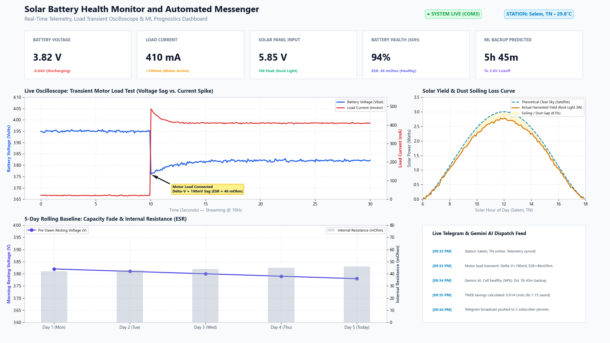

# Solar Battery Health Monitor and Automated Messenger

An intelligent Edge-to-Cloud IoT system that monitors 18650 lithium-ion solar battery health, predicts remaining backup runtime using Machine Learning, calculates TNEB electricity bill savings, cross-references live satellite weather, and sends 5-bullet layman reports via Telegram using Google Gemini AI.

---

##  Quick Setup

### 1. Clone the Repository
```bash
git clone https://github.com/your-username/solar-battery-monitor.git
cd solar-battery-monitor
```

### 2. Install Required Python Libraries
```bash
pip install -r requirements.txt
```

> 📋 **Looking for 1-click copy-paste terminal commands?** Check out the [Installation Guide (INSTALL.md)](INSTALL.md) for individual commands and installation verifications.

---

## ⚙️ Configuration (Secure `.env` Setup)

To keep API keys secure and prevent GitHub secret exposure alerts, copy the `.env.example` template to `.env`:

```bash
cp .env.example .env
```

Open `.env` and set your credentials:

```ini
# 1. Telegram Bot Credentials (from @BotFather)
TELEGRAM_BOT_TOKEN=YOUR_BOT_TOKEN_HERE

# 2. Telegram Alert Chat IDs (comma-separated, from @userinfobot)
TELEGRAM_CHAT_IDS=YOUR_CHAT_ID_1,YOUR_CHAT_ID_2

# 3. Google Gemini AI API Key (Optional: free from https://aistudio.google.com)
GEMINI_API_KEY=YOUR_GEMINI_KEY_HERE
```

*(Optional settings such as `COM_PORT`, `SIMULATE_RAINY_TOMORROW`, and `SIMULATE_DUSTY_PANEL` can still be adjusted directly in `live_monitor.py` or `.env`)*

---

##  How to Run

### Step 1: Train the Machine Learning Model
*(Only needs to be run once)*
```bash
python train_model.py
```
This loads the 18650 dataset, trains the Random Forest Regressors, and exports `battery_model.pkl`.

### Step 2: Upload Firmware to Arduino Nano
1. Connect sensors to Arduino Nano:
   - **Pin A0**: 18650 Battery Voltage Divider (10k resistor)
   - **Pin A1**: Solar Panel Voltage Divider (10k:10k resistors)
   - **Pin A2**: ACS712-05A Current Sensor OUT
   - **Pin A3**: LM35 Temperature Sensor VOUT
2. Open `arduino_sensor.ino` in Arduino IDE.
3. Select Board: **Arduino Nano**, Processor: **ATmega328P**.
4. Upload to your Nano.
5. **Close the Serial Monitor in Arduino IDE.**

### Step 3: Run the Live Monitor
```bash
python live_monitor.py
```

> 💡 **No Hardware? No Problem!**  
> If an Arduino is not plugged in, the system automatically enters **Simulation Mode**, emulating your exact 18650 cell ($3.84\text{V}$), 3W Rock Light solar panel ($5.85\text{V}$), 480mA load current, and 30.5°C cell temperature! Telemetry is logged to `telemetry.db` in real time.

### Step 4: Launch the Real-Time Web Dashboard (Streamlit)
In a new terminal window, run:
```bash
streamlit run dashboard.py
```
This opens the live web interface at `http://localhost:8501`, rendering real-time oscilloscope waveforms, transient motor load voltage sag ($\Delta V$), solar yield vs soiling loss curve, and health diagnostics.


---

## 📬 Sample Predictive Report (Telegram & Console)

```markdown
🤖 Solar Battery Health Monitor & Messenger
📍 Station: Salem, TN • 06:46 PM
────────────────────────────────
• 🔋 Battery Health: 94% (Healthy) • 6h 40m backup tonight
• ⚡ Real Load: 480 mA (1.85 W) • Cell Temp: 31.2°C (Safe)
• ☀️ Solar Panel: 14.5 Wh • Cleanliness: 42% (Dust Detected 🧹)
• 💰 TNEB Savings: 0.015 Units • Saved ₹1.20 today (₹36.00/mo)
• ⛅ Salem Weather: Today: Partly Cloudy (29.8°C) • Cloud Cover 65%
• 🔮 Tomorrow Forecast: Rainy & Cloudy 🌧️ • Rain Chance 85%
• 💡 Smart Advice: 🧹 Panel Dust Detected (-58% loss). However, tomorrow in Salem is forecast to be Rainy (85% rain) — natural rainwater will wash it clean, no manual wiping needed!
```
---

## 💬 Two-Way Interactive AI Battery Doctor (Chatbot)

Users can chat directly with the bot on Telegram (`@mysolar_battery_health_bot`) to get instant answers regarding appliances, battery health, **solar panel dust/cleanliness**, and weather preparation in **English or Tamil**:

### 🗣️ Example Chat Interactions:
* **Solar Panel Dust & Cleanliness Check:**
  > **User:** *"Is my solar panel dirty?"*  
  > **AI Doctor:** *"🧹 Solar Panel Health Check: Cleanliness Score: 42% (Dust Detected 🧹). Optical generation loss is -58% (~1.4W lost under sunshine). 💡 Recommendation: Tomorrow's rain will naturally wash your panel clean!"*

* **Load Estimation:**
  > **User:** *"Can I run a 10W fan tonight?"*  
  > **AI Doctor:** *"⚡ At current voltage (3.88V, ~6.1 Wh usable), a 10W load will run for approx 0h 36m. ⚠️ Warning: Tomorrow in Salem is forecast to be Rainy & Cloudy 🌧️ (85% rain). Solar recharging will be poor tomorrow, so we advise keeping loads under 2W tonight!"*

* **Thermal & Health Diagnostics:**
  > **User:** *"Why is cell temperature 31°C?"*  
  > **AI Doctor:** *"🌡️ Battery temperature is 31.2°C. The optimal range for 18650 Li-ion is 20°C–35°C. The cell is operating within safe thermal parameters with zero thermal degradation."*

* **Regional Language (Tamil / Tanglish):**
  > **User:** *"Solar panel la thusi iruka, sollu?"*  
  > **AI Doctor:** *"🧹 சோலார் பேனல் நிலை: பேனல் கண்ணாடியில் தூசி படிந்துள்ளது (தூய்மை: 42%). இதனால் சோலார் மின் உற்பத்தி -58% குறைந்துள்ளது. கண்ணாடியை மெல்லிய ஈரத்துணியால் துடைக்கவும்!"*

---

## 👥 Authors
Developed for Engineering Mini-Project:  
**Solar Battery Health Monitor and Automated Messenger**
